# HumHub Jitsi Module Improvements

## Scope and delivery

Repo: [`/home/ettienne/Devdisk/THEOILPRESS.ORG/hh-jitsi-meet-cloud/jitsi-meet`](/home/ettienne/Devdisk/THEOILPRESS.ORG/hh-jitsi-meet-cloud/jitsi-meet) (module `jitsi-meet-cloud-8x8`, [`module.json`](module.json) currently **v1.2.1**, `humhub.minVersion` **1.7**).

**Delivery:** one feature branch; commits grouped by phase below. Out of scope: HumHub core admin/account settings.

**Validation notes vs draft analysis:**
- Merge-conflict markers in [`models/SettingsForm.php`](models/SettingsForm.php) are **already gone** (arrow `fn` present). Treat as verify-and-keep, not a live conflict fix.
- CSS already uses HumHub theme vars (`--primary`, `--background-color-main`, …); “Lavivrus” is only a comment. Focus a11y/theme work on hover-only controls, BS3 attrs, inline hex styles, and tour selector mismatch.
- No PHPUnit/tests tree — use manual verification checklist in docs.
- Correct ActiveForm import: `humhub\modules\ui\form\widgets\ActiveForm` (see HumHub [`admin/views/setting/basic.php`](../../HUMHUB-WORKSPACE/tophumhub/protected/humhub/modules/admin/views/setting/basic.php)).

```mermaid
flowchart LR
  subgraph phase1 [Phase1_Security]
    Webhook[Webhook_fail_closed]
    JwtFlow[JWT_server_side_only]
    CacheKey[Moderator_cache_normalize]
    Authz[Permissions_calendar_SSRF]
  end
  subgraph phase2 [Phase2_SettingsGUI]
    ActiveForm[ActiveForm_collapsibles]
    I18n[i18n_ClipboardJs]
  end
  subgraph phase3 [Phase3_RoomUI]
    Tour[Tour_DOM_fix]
    A11y[a11y_BS5_JS_cleanup]
  end
  subgraph phase4 [Phase4_Quality]
    Deps[minVersion_composer_docs]
  end
  phase1 --> phase2 --> phase3 --> phase4
```

---

## Phase 1 — Security hardening (P0 + P1)

### P0 — must ship first

1. **Webhook fail-closed** — [`controllers/WebhookController.php`](controllers/WebhookController.php) `verifySignature()` (~L157–229):
   - When `mode === 'jaas'`, reject if secret empty, header missing, or HMAC invalid (`return false` / HTTP 401–403).
   - Never skip HMAC; stop logging expected signature values (oracle at L229).
2. **Require webhook secret on save** — [`models/SettingsForm.php`](models/SettingsForm.php): add `jaasWebhookSecret` to required-when-jaas rules (server + `whenClient`).
3. **Stop JWT-in-URL** — current leak path:
   - [`RoomController::actionOpen`](controllers/RoomController.php) sets `$jitsiRoomUrl['jwt']` (L541–555)
   - [`views/room/open.php`](views/room/open.php) loads that URL into the modal
   - [`actionModal`](controllers/RoomController.php) trusts `get('jwt')` (L611–626)
   - [`RoomWidget::getData`](widgets/RoomWidget.php) logs full JSON including JWT (L80)
   - **Fix:** `actionOpen` passes only `name` (+ `startSilent`); `actionModal` regenerates JWT from session via `JaasJwtService` / `createJWT`; strip JWT from logs (boolean presence only).
4. **Normalize creator cache keys** — `ensureRoomCreator` already uses `strtolower`; `isModeratorForCurrentContext` at L1094 does **not** — change to `strtolower($roomName)` everywhere.
5. **Guest login return** — `actionOpen` calls `loginRequired()` without returning its response (L527–530); return it.
6. **Remove dead secret** — delete WIP [`JoinRoomForm::getJwt()`](models/JoinRoomForm.php) (hardcoded `my_jitsi_app_secret2`).

### P1 — authz / SSRF

7. **Wire permissions** in [`RoomController::getAccessRules`](controllers/RoomController.php) (today only `CanAccess` + `CanSchedule`):
   - `CreateVideoChat` → create / index POST that starts rooms
   - `JoinVideoChat` → open / modal
   - `ManageRecordings` → details (and any recording download / pre-auth link actions)
8. **Calendar container IDOR** — in `actionSchedule` (~L378–393), before `setContainer`, require create/manage content permission on the target container (reject foreign GUIDs).
9. **SSRF allowlist** — wrap `file_get_contents` of `chat_log_url` / `screen_sharing_url` in `actionDetails` with host allowlist (8x8/JaaS patterns only). In [`JitsiLiveStream`](models/JitsiLiveStream.php), stop treating those URL attrs as user-form `safe` mass-assignable (webhook/admin-only write path).

**Manual verify after Phase 1:** webhook without secret → reject; JWT absent from room open URL / network; second joiner with same room casing does not steal moderator; calendar GUID without permission → forbidden.

---

## Phase 2 — Settings GUI

Refactor [`views/config/index.php`](views/config/index.php) to match HumHub admin settings:

1. Switch `yii\bootstrap\ActiveForm` → `humhub\modules\ui\form\widgets\ActiveForm` with `acknowledge => true`.
2. Replace long flat form + inline `registerJs` with `beginCollapsibleFields` groups:
   - Connection (mode, domain, JWT / JaaS keys + webhook secret)
   - Features (recording, livestream widget, scheduling, tour)
   - Permission defaults
   - Debug (JWT test link)
3. Mode/JWT show-hide: small `humhub.modules.jitsiMeet.config` JS (or declarative collapsible open/closed by mode) — remove the large inline `$script` block.
4. Fix dual `jitsiDomain` dropdown/text binding (one attribute, clear custom-domain UX).
5. i18n mode labels / remaining hardcoded English; ClipboardJs + accessible Copy for webhook URL (pattern from HumHub `ClipboardJsAsset`).
6. Surface private-key path readability errors already partially in `validateJaasPrivateKeyPath` / ConfigController test — ensure save path shows clear admin errors.

Reference pattern: HumHub core admin basic settings + module configs using `beginCollapsibleFields` (e.g. ldap/breakingnews/clean-theme).

---

## Phase 3 — Room frontend / a11y

1. **Tour DOM** — [`widgets/views/streamGuide.php`](widgets/views/streamGuide.php) targets `#jitsi-join-panel`, `#jitsi-active-grid`, `#jitsi-ended-grid`, `#jitsi-guide-button`; [`views/room/index.php`](views/room/index.php) uses `.jitsi-filter-bar` / `.jitsi-actions` with no those IDs. Add stable IDs (or retarget selectors) so tour steps land.
2. **A11y:** always-visible focusable delete controls (today hover-only in CSS ~L532–544); `aria-current` on active filter links; live indicator text/SR label; `prefers-reduced-motion` for pulse animations in CSS/`Events.php`.
3. **BS5:** `data-dismiss` → `data-bs-dismiss` in [`modal_details.php`](views/room/modal_details.php), [`schedule_modal.php`](views/room/schedule_modal.php), [`modal_event.php`](views/room/modal_event.php).
4. Replace hardcoded `#f9f9f9` / inline opacity styles with theme vars.
5. **JS cleanup** — [`resources/humhub.jitsiMeet.js`](resources/humhub.jitsiMeet.js): drop noisy `console.log`; replace `innerHTML` + `error.message` with `textContent` / HumHub status; [`assets/Assets.php`](assets/Assets.php): remove `forceCopy => true` for production.

---

## Phase 4 — Quality / docs

- Bump `humhub.minVersion` toward **1.17** (BS5 assumptions); align `composer.json` PHP `>=8.1` (or 8.2) with arrow/typed usage.
- Generate and commit `composer.lock` for reproducible `firebase/php-jwt` (if intentionally ignored today, stop ignoring for this module).
- Trim verbose `Yii::info` moderator/JWT dumps in production paths.
- Rewrite stale [`docs/TODO.md`](docs/TODO.md) (“Implement JWT support” is obsolete); note CSP/Jitsi load caveats remain in [`docs/INSTALLATION.md`](docs/INSTALLATION.md).
- Bump module version in `module.json` + changelog entry for the release that includes this work.
- Document Phase 1 manual verification steps in CHANGELOG or a short QA note under `docs/` (no test harness present).

---

## Commit / verify cadence

| Commit group | Focus |
|---|---|
| 1 | Webhook fail-closed + required secret + signature log scrub |
| 2 | JWT server-side only + cache key + loginRequired return + dead getJwt |
| 3 | Permissions + calendar authz + SSRF allowlist |
| 4 | Settings ActiveForm / collapsibles / ClipboardJs / i18n |
| 5 | Tour + a11y + BS5 + JS/assets cleanup |
| 6 | minVersion, composer.lock, logging trim, TODO/docs/version |

Smoke after each security commit on local HumHub (`tophumhub-dev` / localhost:9091): admin config save (both modes), room open (check Network for no `jwt=`), webhook POST without secret, moderator with mixed-case room name.
