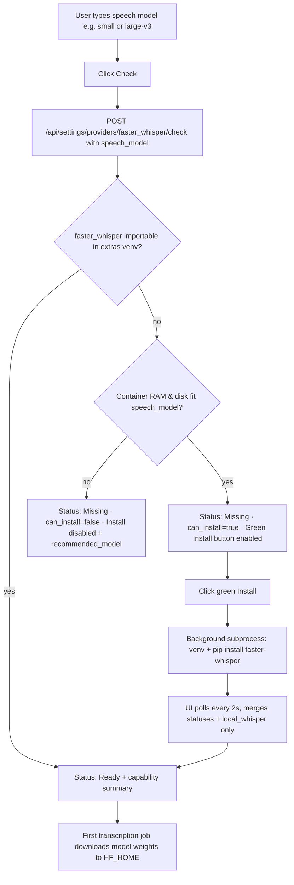

# Local faster-whisper optional install

Work lives in [top-studio](/Volumes/devnvme/Development/THEOILPRESS.ORG/top-studio). This follows [Multi-provider status, roles, and setup help](provider_roles_and_help_e6a18bc3.plan.md) (whose 5 todos are already implemented in `top-studio` and will be marked `completed` alongside this work).

## Validation findings against the codebase (fixed in this revision)

Reviewing the initial draft against the actual `top-studio` code and runtime surfaced seven concrete bugs that would have broken the feature if built as originally written:

1. **`Check` ignored unsaved model edits in the UI.**
   In [ProviderSettings.tsx](/Volumes/devnvme/Development/THEOILPRESS.ORG/top-studio/frontend/src/pages/ProviderSettings.tsx), typing `small` into the Speech model box updates React state (`form.provider_config`), not the database. `POST /api/settings/providers/faster_whisper/check` ([routes.py](/Volumes/devnvme/Development/THEOILPRESS.ORG/top-studio/backend/app/api/routes.py) `ProviderCheckIn`) only accepted `api_key`, `vertex_project`, `vertex_location`, `vertex_bucket`, and [providers.py](/Volumes/devnvme/Development/THEOILPRESS.ORG/top-studio/backend/app/services/providers.py) `_model_for()` read the stored DB slot (still `large-v3`). Typing `small` and clicking **Check** without first clicking **Save settings** would have checked `large-v3` and rejected an 8 GB machine.
   - **Fix:** Add `speech_model: str = ""` to `ProviderCheckIn`, send the card's current `speech.model` from `ProviderSettings.tsx`, and persist that model onto the `faster_whisper` transcription slot during `check_provider()`. Also invalidate `can_install` in the UI whenever the typed model text differs from the `checked_model`.

2. **Prepending `pip install --target` to `PYTHONPATH` breaks core packages and `--reload`.**
   `pip install --target /opt/top-studio/extras/lib "faster-whisper>=1.1"` re-downloads transitive dependencies (`typing_extensions`, `certifi`, `idna`, `urllib3`, `packaging`, `sympy`, `numpy`, `ctranslate2`, `av`, `huggingface_hub`, `tokenizers`, `onnxruntime`). Prepending that directory to `PYTHONPATH` shadows the image's system packages used by FastAPI, Pydantic, and SQLAlchemy. Worse, in [docker-compose.dev.yml](/Volumes/devnvme/Development/THEOILPRESS.ORG/top-studio/docker-compose.dev.yml), `uvicorn ... --reload` watches `PYTHONPATH` dirs — extracting hundreds of wheels into a watched directory triggers mid-install server reloads and kills the background install thread.
   - **Fix:** Use a dedicated virtual environment on the volume (`python -m venv --system-site-packages /opt/top-studio/extras/venv`) and install with `/opt/top-studio/extras/venv/bin/pip install --no-cache-dir "faster-whisper>=1.1"`. `--system-site-packages` reuses packages already in the image and only installs missing ones (`faster-whisper`, `ctranslate2`, `av`, `huggingface_hub`, `tokenizers`, `onnxruntime`). Do **not** touch `PYTHONPATH`; instead, lazily append the venv's `site-packages` path to `sys.path` via `site.addsitedir()` inside the faster-whisper helper so `--reload` never watches it and core packages are never shadowed.

3. **Background install writing to `settings.provider_config` races with `PUT /api/settings` and has no own DB session.**
   FastAPI's `Depends(get_db)` session closes when the HTTP request returns, and `apply_provider_config()` in [providers.py](/Volumes/devnvme/Development/THEOILPRESS.ORG/top-studio/backend/app/services/providers.py) reads `settings.provider_config["checks"]` on save. If a background thread mutates the JSON column while the user saves settings (or vice versa), one overwrites the other.
   - **Fix:** Store live install progress in a small atomic JSON file on the shared volume (`/opt/top-studio/extras/install_status.json`: `state`, `model`, `detail`, `started_at`, `finished_at`, `abi_tag`). Both `app` and `worker` mount `/opt/top-studio/extras`, and `provider_settings_view()` merges this file into the response on every `GET /api/settings`. When the install finishes and imports cleanly, a fresh `SessionLocal()` updates the `faster_whisper` check row to `ready`.

4. **Pre-check status was `"saved"`, and stale `"error"` rows are already in the local DB.**
   In [providers.py](/Volumes/devnvme/Development/THEOILPRESS.ORG/top-studio/backend/app/services/providers.py) L344–349, `_status_for("faster_whisper")` returned `status: "saved"` before any check, and the running dev DB already has a stored `checks.faster_whisper` row with `status: "error"` from `faster-whisper is not installed in this image...`.
   - **Fix:** In `_status_for("faster_whisper")`, check live whether `faster_whisper` is importable in the extras venv. If it is not installed, always return `status: "missing"` (even if an older DB check row recorded `"error"` for the missing-library message), with detail from the latest capability check if present or `"Optional local model — not installed. Choose Check to see if this machine can run it."`

5. **Whole-page polling during install would wipe unsaved Settings edits.**
   In [Settings.tsx](/Volumes/devnvme/Development/THEOILPRESS.ORG/top-studio/frontend/src/pages/Settings.tsx), `api.settings().then(setForm)` replaces the entire `form` state. Polling `GET /api/settings` every 2 seconds and calling `setForm` would overwrite any unsaved text the user is typing in Branding or other provider cards.
   - **Fix:** When polling during `install_state === "running"`, only merge `next.provider_config.statuses` and `next.provider_config.local_whisper` into `form.provider_config` (matching how `onChecked` already updates `form` in `Settings.tsx` L102–113).

6. **Container RAM vs host RAM on macOS / Windows Docker Desktop.**
   Inside Linux containers on macOS/Windows, `/proc/meminfo` `MemTotal` reflects the Docker Desktop Linux VM allocation (often 2–4 GB by default on an 8 GB Mac), while `cgroup` `/sys/fs/cgroup/memory.max` is either `"max"` or a per-container cap. Meanwhile, `MemAvailable` fluctuates with Linux page cache (which the kernel reclaims automatically during `ffmpeg` and model load).
   - **Fix:** Compute effective container RAM limit as `min(MemTotal, memory.max)` (when `memory.max` is numeric) and also read `MemAvailable`. Gate `can_install` on the **effective container RAM limit** (plus a sanity floor on `MemAvailable` so an actively swapping host is flagged), and report both in the UI (`"Container memory: 3.8 GB (3.1 GB available) · Free disk: 42.0 GB"`). If the host is macOS/Windows with a low VM cap, the message explicitly notes that raising Docker Desktop's memory limit unlocks larger models.

7. **Pipeline fallback behavior when `faster_whisper` is turned On.**
   In [pipeline.py](/Volumes/devnvme/Development/THEOILPRESS.ORG/top-studio/backend/app/worker/pipeline.py) `_transcribe`, `first_success()` only moves to the next provider on `RetryableProviderError`. `transcribe_local()` raises `RuntimeError` when uninstalled (non-retryable, which is right so misconfiguration surfaces), but if `faster_whisper` is configured as **Default** and a transient HuggingFace download error (5xx / timeout) happens on first model pull, or if memory allocation fails mid-job, that behavior should be explicit.
   - **Fix:** Keep missing-library as a hard `RuntimeError`, wrap first-run HuggingFace Hub network/5xx failures in `RetryableProviderError` so a configured Fallback (e.g., Groq or OpenAI) can take over if the weight download fails transiently, and include Python ABI tag (`py312-linux-<arch>`) in `install_status.json` so a future base-image Python upgrade cleanly prompts a re-install instead of throwing a native CTranslate2 `.so` error.

## Architecture & Flow



## 1. Shared Volume and Isolated Venv (`extras-volume-venv`)

Mount named volume `extras_data` at `/opt/top-studio/extras` on both `app` and `worker` in [docker-compose.yml](/Volumes/devnvme/Development/THEOILPRESS.ORG/top-studio/docker-compose.yml) (inherited by `docker-compose.dev.yml` and `docker-compose.prod.yml`):

| Path | Purpose |
|---|---|
| `/opt/top-studio/extras/venv` | Virtual environment (`--system-site-packages`) holding `faster-whisper`, `ctranslate2`, `av`, `onnxruntime`, `tokenizers`, `huggingface_hub` |
| `/opt/top-studio/extras/models` | Hugging Face / CTranslate2 model weight cache (`HF_HOME`) |
| `/opt/top-studio/extras/install_status.json` | Atomic install state shared between `app` and `worker` |
| `/opt/top-studio/extras/install.lock` | `fcntl.flock` lock file preventing concurrent installs |

Environment variables in `docker-compose.yml` (`&app_env`) and `Settings` in [config.py](/Volumes/devnvme/Development/THEOILPRESS.ORG/top-studio/backend/app/config.py):

- `EXTRAS_DIR=/opt/top-studio/extras`
- `HF_HOME=/opt/top-studio/extras/models`

New module `backend/app/services/local_whisper_runtime.py`:

- `ensure_extras_venv_on_path(extras_dir: Path) -> Path | None`: locates `/opt/top-studio/extras/venv/lib/pythonX.Y/site-packages`, verifies `install_status.json` matches `sys.implementation.cache_tag` and `platform.machine()`, calls `site.addsitedir(...)` if not already in `sys.path`, and calls `importlib.invalidate_caches()`.
- `import_faster_whisper(extras_dir: Path)`: calls `ensure_extras_venv_on_path` and lazily imports `faster_whisper` (`WhisperModel`). Used by both `check_provider` and [local_whisper.py](/Volumes/devnvme/Development/THEOILPRESS.ORG/top-studio/backend/app/services/transcribe/local_whisper.py) (removing the module-load `try: import faster_whisper` in `providers.py` and `local_whisper.py`).

## 2. Capability Check & Status Rules (`capability-check`)

Update `POST /api/settings/providers/{provider_id}/check`:

- Extend `ProviderCheckIn` in [routes.py](/Volumes/devnvme/Development/THEOILPRESS.ORG/top-studio/backend/app/api/routes.py) with `speech_model: str = ""`.
- In [ProviderSettings.tsx](/Volumes/devnvme/Development/THEOILPRESS.ORG/top-studio/frontend/src/pages/ProviderSettings.tsx), pass `speech_model: speech?.model ?? ""` when calling `api.checkProvider`.
- In `check_provider()` ([providers.py](/Volumes/devnvme/Development/THEOILPRESS.ORG/top-studio/backend/app/services/providers.py)), if `speech_model.strip()` is provided for `faster_whisper`, update the `faster_whisper` slot's `model` in `settings.provider_config["transcription"]` so the checked model is persisted.

Hardware inspection in `local_whisper_runtime.py`:

- **Memory:** Read `/proc/meminfo` (`MemTotal`, `MemAvailable`) and cgroup v2 `/sys/fs/cgroup/memory.max` (or cgroup v1 `/sys/fs/cgroup/memory/memory.limit_in_bytes`), falling back to `os.sysconf` on macOS host unit tests. Effective total RAM is `min(MemTotal, cgroup_max)`.
- **Disk:** `shutil.disk_usage(extras_dir)` (creating `extras_dir` if needed).

Model size table (CPU `int8` execution + ~400 MB wheel overhead when not yet installed):

| Model size | Required container RAM (`ram_total_gb`) | Min available RAM (`ram_available_gb`) | Required free disk (`weights + wheels`) |
|---|---|---|---|
| `tiny` / `tiny.en` | 1.5 GB | 1.0 GB | 0.6 GB |
| `base` / `base.en` | 2.0 GB | 1.3 GB | 0.8 GB |
| `small` / `small.en` | 3.0 GB | 2.0 GB | 1.1 GB |
| `medium` / `medium.en` | 5.0 GB | 3.5 GB | 2.2 GB |
| `large` / `large-v2` / `large-v3` | 7.0 GB | 5.0 GB | 3.7 GB |
| `large-v3-turbo` / `distil-large-v3` | 4.5 GB | 3.0 GB | 2.0 GB |

Unknown custom HuggingFace repo IDs default to the `medium` threshold (5.0 GB RAM / 2.2 GB disk) with a note in `detail`.

Return a `local_whisper` object inside `provider_config` on `GET /api/settings`:

```python
{
    "installed": bool,
    "can_install": bool,
    "checked_model": str | None,      # model that was evaluated during the last Check
    "recommended_model": str | None,  # largest standard model that fits this container
    "ram_total_gb": float,
    "ram_available_gb": float,
    "disk_free_gb": float,
    "install_state": "idle" | "running" | "succeeded" | "failed",
    "install_detail": str,
}
```

Status semantics for `faster_whisper`:

- **Not installed, before or after Check:** `status = "missing"` (never `"error"` or `"saved"`).
  - If Checked and `can_install` is `True`: `"Not installed. This machine can run 'small' (3.8 GB RAM, 42.0 GB free disk). Click Install to add faster-whisper."`
  - If Checked and `can_install` is `False`: `"Not installed. 'large-v3' needs 7.0 GB container RAM (this container has 3.8 GB). Type 'small' and click Check, or raise Docker memory."`
- **Installed and importable:** `status = "ready"`, detail confirms the library imports and whether the typed model also fits container RAM.
- **Install failed or broken native import after install:** `status = "error"`, detail shows the failure reason.

## 3. Install Endpoint (`install-endpoint`)

Add `POST /api/settings/providers/faster_whisper/install` in [routes.py](/Volumes/devnvme/Development/THEOILPRESS.ORG/top-studio/backend/app/api/routes.py):

- Re-runs the capability check on the current `faster_whisper` slot model (or optional `{"speech_model": "..."}` body).
- Returns `409 Conflict` if `faster_whisper` is already installed, if `install_state == "running"`, or if `can_install` is `False`.
- Acquires non-blocking `fcntl.flock` on `/opt/top-studio/extras/install.lock`.
- Writes `install_status.json` with `state="running"`, `detail="Creating extras environment…"`, and starts a daemon thread.
- Background worker thread:
  1. `python -m venv --system-site-packages /opt/top-studio/extras/venv` (if `bin/pip` is not present).
  2. `/opt/top-studio/extras/venv/bin/pip install --no-cache-dir --upgrade "faster-whisper>=1.1"` with `stdout=subprocess.PIPE`, updating `install_status.json` with the latest progress line (e.g., `"Collecting ctranslate2…"`, `"Installing collected packages…"`).
  3. Calls `import_faster_whisper(extras_dir)` to verify CTranslate2 and PyAV load cleanly.
  4. Writes `install_status.json` with `state="succeeded"` (or `"failed"` with the last pip error / network error) and updates `checks["faster_whisper"]` in a short-lived `SessionLocal()` transaction.
- Does **not** flip the `faster_whisper` slot `active` to `True` or change its `role`.
- Does **not** prefetch multi-GB model weights during pip install; the card states that the first job using `faster_whisper` downloads the typed model into `/opt/top-studio/extras/models`.

## 4. Settings UI (`settings-ui`)

In [ProviderSettings.tsx](/Volumes/devnvme/Development/THEOILPRESS.ORG/top-studio/frontend/src/pages/ProviderSettings.tsx) and [Settings.tsx](/Volumes/devnvme/Development/THEOILPRESS.ORG/top-studio/frontend/src/pages/Settings.tsx):

- On the `faster_whisper` card:
  - Show hardware summary line once Checked: `Container RAM: X.X GB · Free disk: Y.Y GB · Recommended max model: <recommended_model>`.
  - Show **Check** button (always available when not currently installing).
  - Show **Install** button next to **Check** when `!localWhisper.installed`:
    - **Enabled & green (`bg-olive text-paper`)** only when `localWhisper.can_install && localWhisper.checked_model === speech.model.trim() && localWhisper.install_state !== "running"`.
    - **Disabled (`border border-line bg-white text-ink/40 cursor-not-allowed`)** before Check, when `can_install` is false, or when the user has edited `speech.model` since the last Check (with inline hint: `"Click Check to verify this model size before installing"`).
    - While `install_state === "running"`, show `"Installing…"` and the live `install_detail` line from `install_status.json`.
- Poll `api.settings()` every 2 seconds in `Settings.tsx` only while `form.provider_config.local_whisper?.install_state === "running"`, merging only `provider_config.statuses` and `provider_config.local_whisper` into `form` so concurrent edits in other cards are untouched.

## 5. Help Copy, Docs, and Tests (`help-docs-tests`)

- Update `faster_whisper` steps in [providerHelp.ts](/Volumes/devnvme/Development/THEOILPRESS.ORG/top-studio/frontend/src/lib/providerHelp.ts) to explain the Check → green Install gate, Docker Desktop memory limits on 8 GB machines, and first-job weight download.
- Update [README.md](/Volumes/devnvme/Development/THEOILPRESS.ORG/top-studio/README.md) provider table row for `faster_whisper`.
- Sync the 5 completed todos in [provider_roles_and_help_e6a18bc3.plan.md](provider_roles_and_help_e6a18bc3.plan.md) so the plan board reflects reality.
- Add `backend/tests/test_local_whisper_install.py` covering:
  - RAM/disk capability matrix (`tiny`, `small`, `large-v3`, `large-v3-turbo`) and `recommended_model` selection.
  - `check_provider` persisting `speech_model` from payload and returning `status="missing"` (not `"error"`) when uninstalled, even if a legacy `"error"` check row existed.
  - `install` endpoint returning `409` when `can_install` is `False` or before Check.
  - `ensure_extras_venv_on_path` discovering `site-packages` and rejecting mismatched ABI tags.

## Out of Scope

GPU/CUDA wheels, baking wheels into the GHCR image, an Uninstall button in the UI, prefetching Hugging Face weights during pip install, and auto-switching the Default transcription provider on install.
