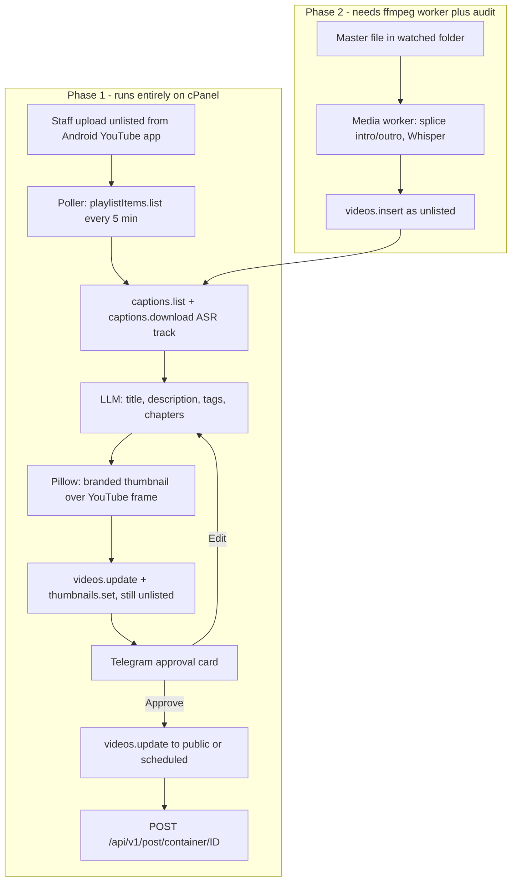

# Oil Press Automation Platform

## My honest read on this project

The idea is sound and the ROI is real, but the requirements as written bundle one genuinely hard thing (intro/outro splicing) with four easy, high-value things (transcript, metadata, thumbnail, cross-posting). Splitting them is worth far more than any technology choice you make.

**The high-value, low-risk part** is everything that happens to a video *after* it exists on YouTube: generating a strong title, a full description with ministry boilerplate and links, keyword tags, auto chapters from the transcript, a branded thumbnail, then a human approving it and the system publishing plus cross-posting to HumHub. This saves real time on every single video, needs no file transfers, no ffmpeg, no extra hosting, and no approval from Google. It runs on your existing cPanel account.

**The expensive part** is intro/outro splicing. It forces a master-file pipeline, a machine that can run ffmpeg, API uploads, and a YouTube compliance audit. It is the only requirement that does this, and it saves perhaps two minutes of editor time per video. I would build it second, and only after deciding it is genuinely worth it. Worth questioning: front-loaded intros generally hurt retention. An end-screen or outro is more defensible than an intro, and YouTube's native end screens may cover it without any splicing at all.

**Automation 3 (Shorts)** should stay parked until 1 and 2 are boringly reliable. Auto-cut Shorts with no human eye tend to look spammy and can drag channel-wide performance down. The infrastructure it needs is the same as Phase 2, so it costs little extra once Phase 2 exists.

## Hard constraints I verified

- **There is no API to download your own video.** `videos.list` with `part=fileDetails` returns filename, size, codecs and duration, but never the media. The only way to get bytes back is `yt-dlp`, which breaches the YouTube ToS your API project would be audited against. Do not build on it.
- **Videos uploaded via `videos.insert` from an unverified API project are locked private**, and setting `privacyStatus` to unlisted or public does not lift it. There is no appeal. The project must pass a [YouTube API compliance audit](https://developers.google.com/youtube/v3/guides/quota_and_compliance_audits) first. This gate applies only to `videos.insert`. It does **not** apply to `videos.update`, which is why Phase 1 avoids it entirely.
- **Quota is a non-issue now.** Since 1 June 2026 `videos.insert` costs 1 unit against its own 100-calls-per-day bucket, not 1,600 units from the shared pool. Most guides online are two revisions out of date. `videos.update` and `thumbnails.set` are 50 each, `playlistItems.list` and `videos.list` are 1.
- **OAuth:** no Google Workspace means an External app. Leave it in "Testing" and your refresh token dies every 7 days. Set publishing status to **In production** and it does not. YouTube scopes are classified *sensitive*, not *restricted*, so there is no annual third-party security assessment. You will click through an "unverified app" warning once, and the 100-user cap is irrelevant at one user.
- **Push notifications won't work.** YouTube's PubSubHubbub feed excludes unlisted videos, so polling is correct regardless.
- **Custom thumbnails** require the channel to be phone-verified. Worth confirming before building the thumbnail step.

## Architecture



The control plane owns all state and runs on cPanel. The media worker, when it exists, polls the control plane over HTTPS for jobs — outbound only, so the office machine needs no inbound ports or firewall changes.

## Phase 1: enrich and publish in place

This is the whole of Automation 1 except the splicing, plus all of Automation 2. No API upload, so no compliance audit, no locked-private risk.

**Detection.** Cron every 5 minutes calls `channels.list(mine=true)` once at startup to get the uploads playlist ID, caches it, then `playlistItems.list` to find videos not yet in the local database. Authorized as the owner, this includes unlisted. Persist seen IDs so restarts don't reprocess.

**Transcript.** `captions.list` for the video, pick the track with `trackKind: "asr"`, then `captions.download?tfmt=vtt`. Auto-captions take anywhere from ten minutes to several hours to appear, so this needs a retry queue with backoff, not a single attempt. If it still fails, flag it to Telegram rather than guessing — a 403 here is a known quirk, and Phase 2's Whisper path is the permanent fix.

**Metadata.** One LLM call over the timestamped transcript producing: three title candidates, a description (short video-specific summary, then your standard Oil Press boilerplate and links from a config file, then chapter timestamps), and 15 to 20 tags. Two things to keep in mind: tags carry very little SEO weight these days compared to title, thumbnail and the first two lines of the description, so don't over-invest there; and chapter timestamps are a free, genuinely useful addition you didn't ask for that the transcript makes trivial.

**Thumbnail.** Pull the YouTube-generated frame from `snippet.thumbnails.maxres`, composite your branding and the title with Pillow. No ffmpeg needed because the frame comes from YouTube. A consistent branded template will outperform AI-generated art for a ministry channel and costs nothing per video.

**Human gate (Telegram).** Telegram over WhatsApp, firmly: the Bot API is free and instant, whereas WhatsApp Business API needs Meta approval, a solution provider, per-message fees and 24-hour session rules. The bot sends the thumbnail, proposed title, description preview and tags with inline buttons for Approve, Approve and schedule, Regenerate, and Reject. Replying to the message with text overrides the title. Restrict the bot to an allowlist of chat IDs.

**Publish and cross-post.** On approval, `videos.update` sets `privacyStatus` to public or sets `publishAt` for scheduling, then `thumbnails.set`. Then post to HumHub via the REST module: authenticate with `POST /api/v1/auth/login` for a JWT, then `POST /api/v1/post/container/{containerId}` with `{"data":{"message":"..."}}`. Needs a dedicated bot user with access only to the target space, and the space's content container ID looked up once.

## Phase 2: intro/outro splicing (decision gate)

Only start this once Phase 1 is running and you've confirmed the intro is worth the machinery.

Two routes, and I'd de-risk by building toward both:

- **Full automation.** Master file lands in a watched folder, worker splices and transcribes with Whisper, control plane calls `videos.insert`. One human touch total. Requires passing the compliance audit — submit the application the day Phase 1 goes live, since it takes weeks and the Phase 1 dashboard screenshots are exactly the evidence the form asks for under "Internal Company Tool".
- **Fallback if the audit is rejected.** Worker renders the spliced file and drops it back in a shared folder; a person uploads it from the YouTube app as they do today; Phase 1 picks it up and does everything else. Two human touches instead of one, but zero audit dependency and zero risk of a locked-private video.

The worker runs on the head-office Windows machine under Docker as you suggested, polling the control plane for jobs. If that machine proves unreliable, moving the identical container to a 6-dollar VPS is a configuration change, not a rewrite. The shared cPanel account cannot do this work — video encoding on CloudLinux LVE limits will either be killed or get the account flagged.

## Phase 3: Shorts

Same worker, same master files. LLM picks candidate moments from the timestamped transcript, ffmpeg crops to 9:16 and burns in captions, upload as a separate video with a link back. Shorts are capped at 3 minutes. Keep the Telegram gate — review every one.

## Stack: Python service, not n8n

Build a Python service as the system of record. The reasoning is specific to your situation rather than general preference:

- The genuinely hard parts — ffmpeg invocation, resumable uploads, transcript chunking, retry and state machines, OAuth refresh — are code either way. n8n would wrap them in Execute Command nodes and add an opaque layer over the same code.
- You explicitly want to maintain this with Cursor and LLMs. That works extremely well against a Python repo with readable diffs, and extremely badly against n8n's exported workflow JSON.
- Your security instinct about n8n is correct. The Code node is arbitrary JS execution, so anyone reaching the UI has code execution on the host, and it holds your YouTube OAuth credentials encrypted with a key sitting in env on the same box. Self-hosting it internet-exposed to hold channel-management credentials is a bad trade.

n8n still has a place later: on the office LAN only, never exposed, as a GUI glue layer for *new, simple* automations (also posting to Facebook or X, for instance) that call your Python API over webhooks. That gives you the nice GUI for future work without putting the credentials or the critical path inside it.

Concretely: Python 3.11+, FastAPI for the Telegram webhook and later the dashboard, SQLite with WAL for state, `google-api-python-client` for YouTube, `httpx` for HumHub and Telegram, Pillow for thumbnails. Drive the pipeline from cPanel cron every 5 minutes rather than an in-process scheduler — Passenger idles apps out and can spawn duplicates, so each cron run should be a short, stateless pass over the queue.

## Hosting, git and deploy

New standalone repo, not inside any existing workspace repo. Suggest `/Volumes/devnvme/Development/THEOILPRESS.ORG/oilpress-automation/`.

cPanel's Git Version Control gives you a bare repo on the server with a post-receive hook that runs `.cpanel.yml` on push, so GitHub is genuinely optional:

```yaml
deployment:
  tasks:
    - export DEPLOYPATH=/home/USER/apps/oilpress-automation
    - /bin/cp -r . $DEPLOYPATH
    - /usr/bin/touch $DEPLOYPATH/tmp/restart.txt
```

Branch model: `main` for development, `prod` as the only branch pushed to the cPanel remote. The `touch tmp/restart.txt` line matters — Passenger serves stale code until you restart it, and this catches people out repeatedly.

**Add a second remote regardless.** A single copy of the repo on shared hosting is one account suspension away from total loss. A private GitHub repo or a bare repo on local storage both work; this is cheap insurance and your workspace rules already call for pushing work off the local machine immediately.

App code lives outside `public_html`. Secrets go in a `.env` outside the web root and in the cPanel Python App environment variable UI, never in the repo. The OAuth refresh token is the crown jewel here — treat it like a password.

## Cost

Phase 1 is effectively free: YouTube API free tier, YouTube's own ASR for transcripts, Pillow for thumbnails, Telegram free, existing cPanel hosting. LLM metadata generation is cents per video.

Phase 2 adds Whisper (about 36 cents for a 60-minute sermon via API, or free on local hardware) and either the office machine or roughly 6 to 12 dollars a month for a VPS. Realistic all-in ceiling is 15 dollars a month.

## Risks worth naming now

- **Compliance audit rejection** kills full Phase 2 automation. Mitigated by the manual-upload fallback above, and by Phase 1 delivering most of the value without it.
- **ASR captions unavailable or 403.** Retry with backoff, flag to Telegram, and let Phase 2's Whisper path be the permanent fix.
- **OAuth token revocation** from a password change or Google security event will silently break everything. Build a `/auth` re-consent route and alert to Telegram on the first refresh failure, not the tenth.
- **Shared hosting killing processes.** Cron-driven stateless passes rather than long-running loops, and assume the app can be restarted at any moment.
- **The gate is the product.** This pipeline is only as trustworthy as the review step. Build it properly from day one rather than bolting it on.

## Open decisions

- Roughly how many videos per week? Under two or three, the payback period on Phase 2 is long enough that I'd question building it.
- Is the intro actually required, or would YouTube's native end screens cover the outro need without any splicing?
- Which HumHub instance and space is the target, and is the REST module already enabled there?
- LLM provider preference and whether there's a budget ceiling.
