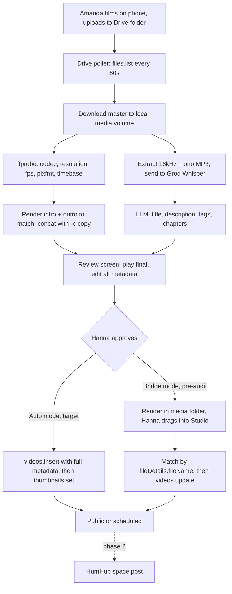

# Oil Press Studio - local Docker dashboard MVP

Supersedes the cPanel/Telegram plan, which stays on disk for reference. The shift to a local Docker stack with a LAN dashboard is the right call: the heavy work is ffmpeg and transcription, and a dashboard is a far better fit than chat buttons for a review step that involves watching a video.

## The upload question, answered

You cannot edit an uploaded video's content. YouTube Studio can trim, blur, swap audio and add end screens, but it has never been able to prepend footage or replace a file, and there is no API for any of it. So "upload raw to YouTube, then let the server add the intro" has no implementation.

Your instinct about avoiding policy trouble was still correct, just applied in the wrong place. Human upload does sidestep the compliance audit. But if the raw clip goes to YouTube first, the only way to splice it is to pull it back with `yt-dlp`, which is a worse ToS breach than the one you were avoiding. The route that feels safe ends at the riskier action.

The resolution is the one you already picked: Amanda uploads raw footage to Google Drive, not YouTube. Drive API downloads of your own files are fully supported and carry no policy risk whatsoever. YouTube only ever sees the finished video.

## Two things that will bite you operationally

**Hanna's channel-manager grants are useless to the API.** YouTube's [channel permissions documentation](https://support.google.com/youtube/answer/9481328) lists "YouTube APIs" among the things invited users cannot access, and the Brand Account migration page states it directly: invited users "can't manage via YouTube APIs." Since Hanna owns the account this is fine, but it means she personally completes the OAuth consent on each install, including yours. Each install holds its own refresh token. Logging into her Google account on your Mac mini works, though it is cleaner to have her click consent on your machine rather than hand over the password.

**Bandwidth and Drive storage are the real constraint, not compute.** Seven videos a week at 15-30 minutes each from a phone is roughly 10-17 GB per week of mobile upload, and about 50 GB a month of Drive storage. Three things make this manageable, and they should be set up before Amanda's first trip:

- Set the phone to record 1080p30, not 4K. This cuts file size by four to six times with no meaningful quality loss for this content.
- Set the Google Drive Android app to upload on Wi-Fi only. Amanda films through the day, the uploads drain at the hotel overnight, and nothing is lost if signal is poor.
- The server deletes the Drive source after a confirmed successful render, so storage stays flat. A Google One 100GB plan is still worth having as headroom.

## Architecture

## The splice

Intro and outro are not fixed MP4 files. They are generated per video from source assets, which is what makes mixed orientation a non-issue.

- **Intro:** a premade video clip, uploaded in Settings. It is re-encoded to the footage's exact dimensions, frame rate, pixel format, and timebase, then joined with stream copy. Optional landscape and portrait clips are chosen from orientation.
- **Outro:** a Pillow-composed card with the website URL and a QR code pointing at the live app-install instructions page, generated with the `qrcode` library so the target stays a dashboard setting rather than a baked-in image.

The pipeline runs `ffprobe` on the master, renders both segments to match its codec, resolution, pixel format, frame rate, timebase and audio layout, then joins all three with the concat demuxer and `-c copy`. The main body is never re-encoded. The ffmpeg docs are strict that all files must share the same streams and timebase for this to work, so the match step needs to be exact and the pipeline should verify the output duration before declaring success.

A 20-minute splice takes seconds rather than minutes, and only about 15 seconds of footage is ever encoded. This is what makes the whole thing viable on a laptop, and it is why the absence of a GPU barely matters.

## Transcription without a GPU

Local Whisper is off the table if Hanna is on a laptop, and Docker Desktop on macOS cannot reach Metal anyway, so an Apple Silicon machine gets no acceleration inside a container either. Use a hosted provider behind a pluggable interface with the key in `.env`.

**Groq `whisper-large-v3-turbo` as the default.** The free tier allows 28,800 audio seconds per day, which is eight hours. At seven videos a week averaging 20 minutes you need roughly three and a half hours per *week*, so this sits permanently inside the free tier with enormous headroom. If you ever outgrow it, the paid rate is four cents per audio hour, which is about a dollar a month at your volume.

Two implementation details that matter:

- The free tier caps uploads at 25 MB. Raw 16kHz mono WAV for 30 minutes is around 58 MB and even FLAC lands near 30 MB, both over the limit. Preprocess with ffmpeg to 16kHz mono MP3 at 64kbps, which puts 30 minutes at roughly 14 MB with no meaningful accuracy loss, since Groq downsamples to 16kHz mono regardless.
- Request `verbose_json` so you get segment timestamps, which is what the chapter generator needs. Chunk with overlap for anything beyond about 45 minutes and deduplicate words across boundaries.

Build the interface with OpenAI as a drop-in fallback (same OpenAI-compatible endpoint shape) and local `faster-whisper` as an optional provider for the Mac mini when you want to work offline.

Also support the GCP project that already has to exist for YouTube and Drive:

- **Google AI Studio** (`GEMINI_API_KEY`, model `gemini-2.5-flash`). Gemini accepts the audio and returns a transcript with segment timestamps as JSON. The free tier is a request and token quota, not audio-hours. The same key can write the metadata.
- **Vertex Gemini** uses that same model on the GCP project (service account or ADC).
- **Vertex Speech-to-Text Chirp** (`chirp_2`) is the dedicated speech model. Long files go through a Cloud Storage bucket (`VERTEX_STT_BUCKET`).

Groq stays the default because its free tier is the one measured in audio-hours.

## Publishing

**API upload is the target design,** as you asked. `videos.insert` carries title, description, tags, category and privacy in a single resumable upload, then `thumbnails.set` follows. Hanna's involvement collapses to reviewing and clicking Approve.

The unavoidable catch is that this now puts the compliance audit squarely on the critical path. Videos uploaded through `videos.insert` from an unverified API project are **locked private**, and that state cannot be appealed or undone — the video has to be deleted and re-uploaded through an audited client or the YouTube app. So two things follow:

- **Submit the [audit form](https://developers.google.com/youtube/v3/guides/quota_and_compliance_audits) the moment the Review screen is screenshot-able.** It asks for exactly the OAuth flow and upload interface evidence the dashboard will produce. Expect weeks, so this should be in flight long before the rest is finished.
- **Never point pre-audit `videos.insert` testing at the real Oil Press channel.** Every test produces a permanently locked video that can only be deleted. Create a free throwaway Brand channel on your own Google account for that work.

**Bridge mode covers the gap.** Until approval lands, the approved render drops into the media folder, Hanna drags it into YouTube Studio with no metadata, and the dashboard matches the new upload exactly on `fileDetails.fileName` (which we control, since we named the render) and then applies everything via `videos.update` and `thumbnails.set`. That is one drag-and-drop per video, and the private-lock restriction does not apply because nothing was inserted through the API. Keep it as a permanent fallback rather than throwaway code, since it is also your escape hatch if the audit is ever rejected or revoked.

Quota is a non-issue either way: `videos.insert` now costs 1 unit against its own 100-per-day bucket, `videos.update` and `thumbnails.set` are 50 each, and the Drive and playlist polling is 1 unit per call.

## Dashboard MVP

Four screens for MVP, built so each can grow:

- **Inbox.** Drive files detected, with per-video pipeline status and progress: downloading, rendering, transcribing, generating, ready for review.
- **Review.** The payoff screen. Plays the rendered final so Hanna can confirm the intro and outro landed correctly, with every field editable beside it: title, description, tags, chapters, thumbnail with a regenerate button, publish now or schedule. One Approve button at the bottom.
- **Channel.** YouTube videos with thumbnails and privacy state, so Hanna can see what is unlisted, draft, scheduled or live, and enrich anything that arrived outside the pipeline.
- **Settings.** Google connection status with connect and disconnect, Drive folder selection, branding assets (logo, intro sound, QR target, website URL), the description boilerplate template, transcription and LLM provider keys, and the publish mode toggle. HumHub settings get added here in phase 2.
- **Jobs.** Queue state, retries, failures with readable errors. This is what makes the thing debuggable at 7am when a render failed overnight.

On notifications: in-dashboard toasts only fire while the tab is open. A pinned tab plus the browser Notifications API and a count badge in the title covers it without any native component. Worth setting expectations that nothing reaches Hanna when the browser is closed.

## Stack and cross-platform support

FastAPI backend, React with Vite, Tailwind and shadcn/ui for the frontend, Postgres for state. Three containers via Docker Compose: `app` (API plus built static frontend), `worker` (ffmpeg, Drive and YouTube jobs), and `db`.

Postgres rather than SQLite because two containers writing a SQLite file over a Docker Desktop bind mount is a known source of intermittent corruption on both macOS and Windows, and Postgres is what the VPS move needs anyway. It costs one line of compose config.

Running on your Mac mini, Hanna's laptop and Linux alike drives several concrete choices:

- **Multi-arch images.** GitHub Actions builds `linux/amd64` and `linux/arm64` and pushes to private GHCR, so Apple Silicon and Intel/AMD both pull a native image. This also means Hanna never builds anything: her install is a `docker-compose.yml`, a `.env`, and `docker compose up -d`.
- **No hardware encode anywhere.** Docker Desktop on macOS runs a Linux VM with no VideoToolbox passthrough, and you are not betting on NVIDIA on Hanna's laptop. The stream-copy splice design means this costs you almost nothing, and hosted transcription removes the other GPU dependency.
- **`MEDIA_DIR` as an env var** for the bind mount, since the path differs per OS. Still a bind mount rather than a named volume so the rendered files are reachable in Finder or Explorer for bridge-mode uploads.
- **OAuth redirect URIs** must be `http://localhost:PORT/...`. Google permits localhost but rejects raw private IPs like `192.168.1.x`, which is another reason the localhost-only decision is the right one.

The product name is **TOP Studio**. The repo is standalone at `/Volumes/devnvme/Development/THEOILPRESS.ORG/top-studio/` and the private remote is `https://github.com/jhweb/top-studio`. `main` is the development environment (local build, Vite) and publishes `ghcr.io/jhweb/top-studio:dev`. `prod` is the production environment (GHCR image, Watchtower) and publishes `:prod`. `./bin/studio` selects the compose overlay from the current branch. This Mac mini is Apple Silicon (M1), so local runs exercise `linux/arm64` first. Hanna's laptop is Windows.

## Updates and operations

Docker Desktop is free for organisations under 250 employees and under $10M revenue, which Oil Press comfortably is.

Watchtower in the compose stack, watching the GHCR images, gives hands-off updates on every platform with no PowerShell, no shell scripts and no git on Hanna's machine. The dashboard shows the running image tag and a banner when a newer one has been pulled. Set `restart: unless-stopped` on every service and enable Docker Desktop's start-on-login so the stack comes up with the machine.

Private GHCR images need a one-time `docker login` with a read-only PAT on each machine. If that friction is not worth it, making the images public is defensible since no credentials are baked into them, but default to private.

## Security of a no-auth local app

Binding to localhost only is defensible, but the thing it is protecting is significant: a refresh token with full control of the YouTube channel.

- Pin the compose port mapping as `127.0.0.1:8080:8080`, not `8080:8080`, and comment why. Changing that one line silently exposes an unauthenticated channel-publishing tool to the whole office network including guest Wi-Fi.
- Encrypt OAuth tokens at rest with a key from a gitignored `.env`, so a stolen database file alone is not enough.
- Enable full-disk encryption on every machine running this: FileVault on the Mac mini, BitLocker on Hanna's laptop, LUKS on Linux.
- Never commit the media bind mount or the data volume.

## Designing for the SaaS future at near-zero cost now

Three decisions cost nothing today and save a rewrite later:

- Scope every database row by an `account_id` from the first migration, even though it is always 1.
- Put all branding, boilerplate, links and templates in a settings table. Nothing about "The Oil Press" should be hardcoded.
- Store credentials per account, not as global environment variables.

One commercial reality to plan around: a multi-tenant product that uploads to YouTube on behalf of other people's channels needs both the compliance audit and full Google OAuth verification, including brand verification and a demo video. YouTube scopes are classified sensitive rather than restricted, so there is no annual third-party security assessment and no five-figure cost. It is a real path, just a slow one — and the audit you are starting now is the first half of it.

## Cost

Google One 100GB at roughly R35 a month, Groq transcription free at this volume, LLM metadata generation under two dollars a month for 30 videos, Docker free. Call it three dollars a month all in.

## Risks

- **The audit is now a hard dependency** for the UX you want. Bridge mode means you are never blocked from shipping, but plan for weeks of running in bridge mode and do not promise Hanna one-click publishing on day one.
- **Pre-audit testing can junk the real channel.** Locked-private videos cannot be recovered. Use a throwaway test channel and gate `videos.insert` behind an explicit environment flag so it cannot fire by accident.
- **The machine is off.** Nothing processes. Jobs queue and drain when it boots, which is acceptable with a human gate anyway, but Amanda's videos sit untouched over a long weekend.
- **Phone footage is wildly inconsistent** across orientation, frame rate and codec (HEVC vs H.264). The match-and-stream-copy approach depends on handling this correctly. Build a fallback path that full re-encodes when the probe finds something the concat demuxer will reject, and log loudly when it triggers. On a laptop with no GPU, that fallback on a 30-minute 4K file will take a long time, which is another reason to lock Amanda's phone to 1080p30.
- **Token revocation.** If Hanna's password changes or Google fires a security event, publishing stops on every install at once. Visible connection status and one-click reconnect, on every screen that matters.
- **Mobile upload reliability.** Amanda's half-uploaded files will appear in Drive. The poller must check that the Drive file size is stable across two polls before starting a download.

## Still open

- Create the GCP project, set the OAuth consent screen to In production, and have the channel owner complete consent.
- Submit the YouTube API audit, and use a throwaway channel for any pre-audit `videos.insert` tests.
- Phase 2: which HumHub instance and space, and is the REST module enabled with a bot user available?
