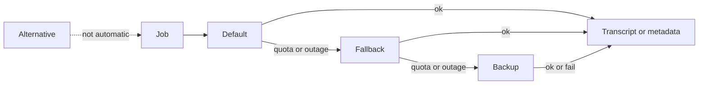

# Multi-provider status, roles, and setup help

## What is true today

Saving a Google AI Studio key and a GCP project id stores two separate credential sets. The job uses only the one engine chosen in the Transcription dropdown ([frontend/src/pages/Settings.tsx](frontend/src/pages/Settings.tsx), [backend/app/worker/pipeline.py](backend/app/worker/pipeline.py) `_transcribe` / `_metadata`). A quota error fails the job. There is no fallback.

The open menu in the screenshot is not a model list from Groq or Google. It is a hardcoded engine list in `Settings.tsx`. The real model ids are mostly locked in code:

- Groq speech always sends `whisper-large-v3-turbo` ([backend/app/services/transcribe/whisper_api.py](backend/app/services/transcribe/whisper_api.py)).
- OpenAI speech always sends `whisper-1`.
- Gemini uses server env `GEMINI_MODEL` (`gemini-2.5-flash`). The form shows that name in the paragraph and cannot edit it. Metadata for Gemini ignores the “Metadata model name” field and uses the same env value ([pipeline.py](backend/app/worker/pipeline.py) around the `generate_metadata` call).
- Chirp model and the Groq/OpenAI metadata model are already free text.

Each provider card will have its own typed model id, with the current default as the placeholder. The app will not fill a dropdown from a vendor model catalog.

Vertex location, Chirp model, and bucket are not loaded back after save (they live in the encrypted `vertex` secret and the inputs start blank). Non-secret fields will round-trip. API keys stay write-only, shown as saved or empty.

## Roles

Two independent chains: transcription and metadata. A speech fallback does not change which model writes the title.

On each card, one role per job it can do:

- **Default** — used first. Exactly one per chain. Choosing Default on another card moves the previous Default to Fallback.
- **Fallback** — tried next, in card order, only after a quota, rate-limit, or provider outage.
- **Backup** — tried after every Fallback with the same kind of error.
- **Alternative** — kept configured and checkable. The pipeline does not switch to it.

Inactive cards are skipped. Chirp and local faster-whisper are transcription only. Groq, OpenAI, AI Studio, and Vertex Gemini can do both jobs. One Groq key (and one OpenAI key, one AI Studio key, one GCP project) is shared by both jobs. Vertex Gemini and Chirp share project id, location, and the service-account file; Chirp adds the bucket and its own model id.

Errors that move to the next role: HTTP 429, 500, 503, and Gemini `RESOURCE_EXHAUSTED`. A missing key, a 401/403, or a successful call that returns bad text stops and surfaces the error so the next provider’s quota is not spent by accident.

## Settings UI

Replace the two dropdowns and the flat key list inside the Transcription and metadata card with one card per provider:

- On/off for transcription, and for metadata when that provider can write metadata.
- Role control (one of the four tags).
- Model id text field (speech model, and a second field when the provider also writes metadata).
- The key or GCP fields that belong to that provider.
- Status: Missing, Saved, Ready, Error, or Quota, plus the last check message.
- A Check button that calls a cheap auth probe and stores the result. “Saved” means the secret exists. “Ready” means the last check succeeded.

A Help button in the card header (top right of that section) opens a dialog. The dialog lists the six providers and shows the steps for the one you pick. Each provider card also has a small help control that opens the same dialog on that provider.

Setup copy, kept in a static frontend module:

- **Groq** — key from console.groq.com. Speech default `whisper-large-v3-turbo` (free tier is audio-hours, about eight hours a day). Metadata default `llama-3.3-70b-versatile` (separate token quota).
- **OpenAI** — key from platform.openai.com, billing required. Speech `whisper-1`. Metadata example `gpt-4o-mini`.
- **Gemini via AI Studio** — key from aistudio.google.com/apikey. This key is not the GCP project. Model `gemini-2.5-flash` for speech and metadata. Free tier is requests and tokens, not audio-hours.
- **Gemini on Vertex** — billing on the GCP project, Vertex AI API enabled, project id and location (`us-central1`). The service-account JSON stays on the server as `GOOGLE_APPLICATION_CREDENTIALS`. It is not pasted into this form.
- **Chirp** — same project and service account, Speech-to-Text API enabled, a Cloud Storage bucket in that region, model `chirp_2`. Long files are uploaded to that bucket. Transcription only.
- **Local faster-whisper** — not in the default image (`local-whisper` extra). Model size such as `large-v3`. No key and no cloud quota.

## Backend

- Add `provider_config` JSON on `account_settings` (Alembic revision after [002_channel_thumbnails.py](backend/alembic/versions/002_channel_thumbnails.py)). Shape: `{ transcription: ProviderSlot[], metadata: ProviderSlot[] }` where each slot is `{ id, active, role, model }`. Keep `transcription_provider`, `llm_provider`, and `llm_model` as the current Default so older reads still work.
- New [backend/app/services/providers.py](backend/app/services/providers.py): resolve the ordered chain (default, then fallbacks, then backups), skip inactive and alternative, and classify retryable errors.
- [factory.py](backend/app/services/transcribe/factory.py) and [metadata.py](backend/app/services/metadata.py) accept the typed model id. Whisper, Gemini, and Chirp raise a retryable error on quota and 5xx.
- `_transcribe` and `_metadata` walk the chain and append which provider ran, and which were skipped, to the job log.
- `GET /settings` returns the chain, non-secret fields (location, bucket, models, last status), and secret-present flags. `PUT /settings` saves the chain and secrets. `POST /api/settings/providers/{id}/check` probes that provider and stores status, detail, and checked time.
- Probes: Groq and OpenAI `GET /models` with the key; AI Studio models list with the key; Vertex and Chirp mint an access token and, for Chirp, require project and bucket; local checks that `faster-whisper` imports. No audio is sent.

## Out of scope

Uploading the GCP service-account JSON in the browser, live vendor model catalogs, and per-video manual provider picks. Alternative stays a configured spare until a later job-level picker.